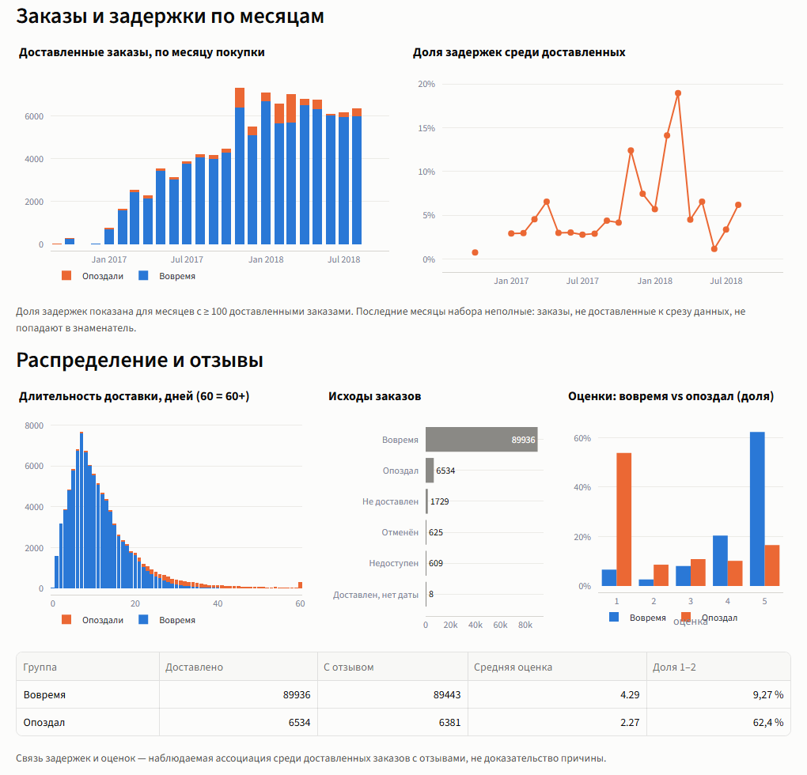
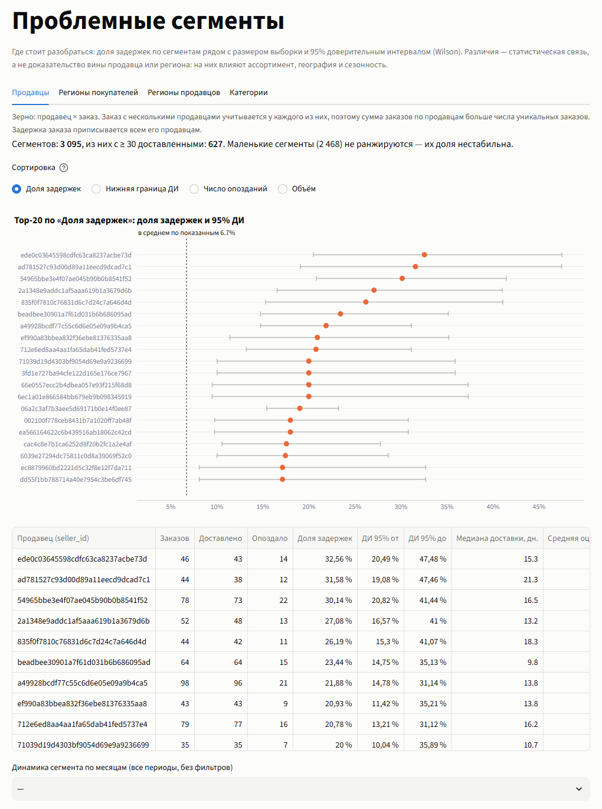
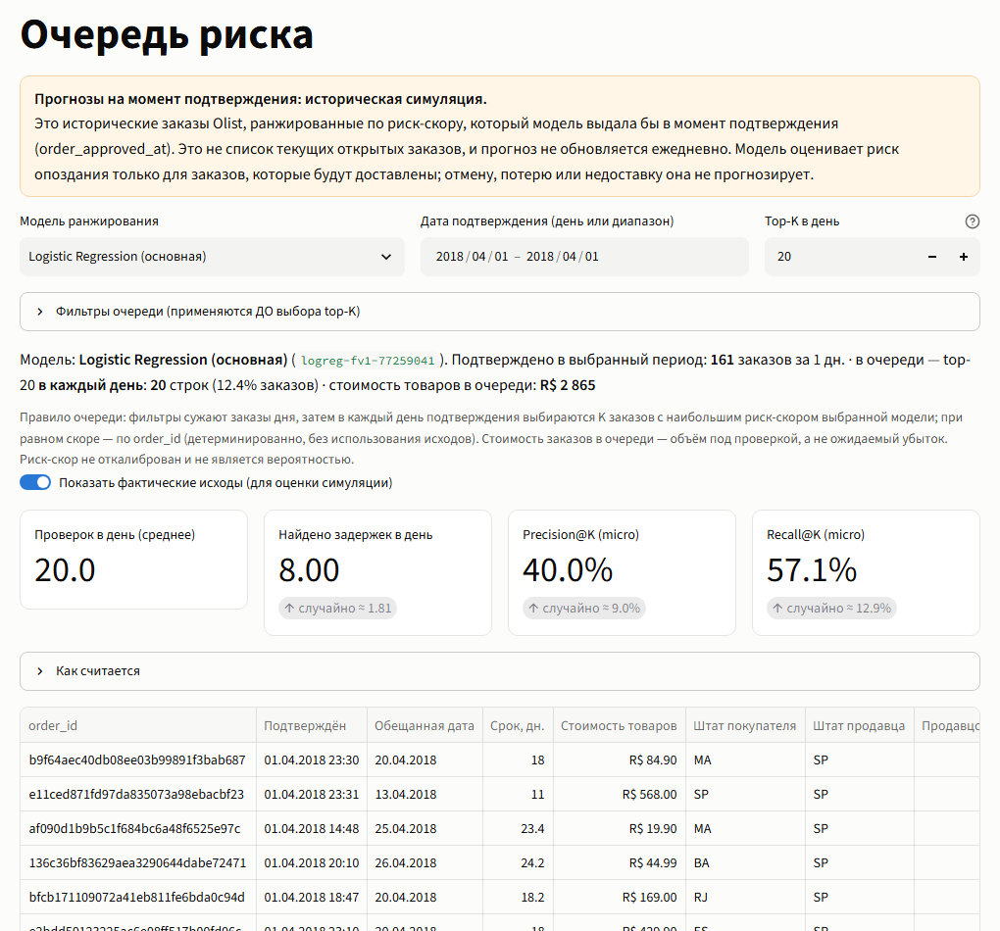
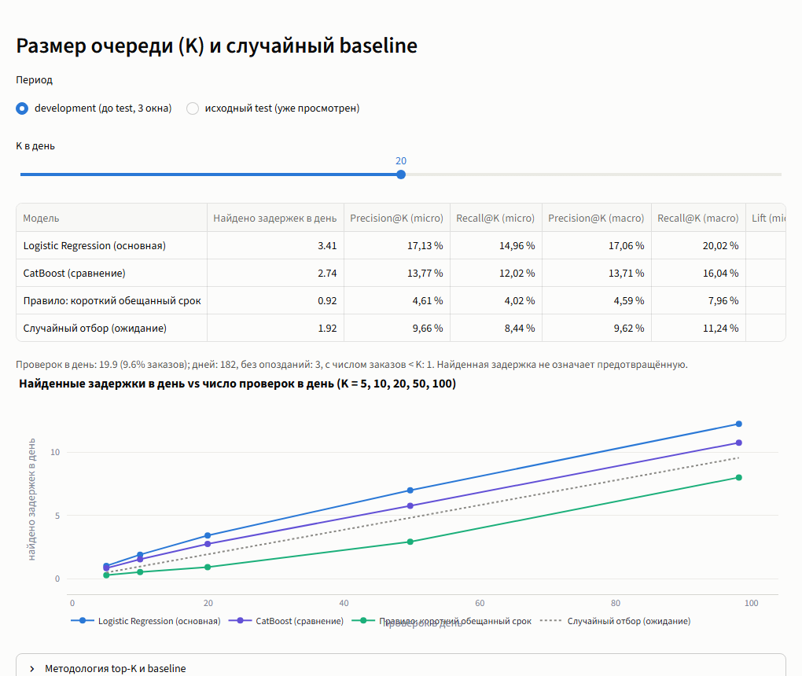

# OrderPulse

[](https://github.com/7SUNNY77/orderpulse/actions/workflows/ci.yml)

**OrderPulse** — приложение, которое помогает интернет-магазину следить за доставкой: показывает, где заказы
опаздывают, и каждый день подсказывает, какие новые заказы стоит проверить в первую очередь.

*English:* E-commerce delivery analytics and daily risk prioritization on the Olist dataset, with temporal
backtesting and interpretable ML. The app shows where deliveries run late and ranks each day's new orders by delay
risk, explaining every score. The UI and docs are in Russian.


## Зачем это нужно

Представьте менеджера, который успевает вручную проверить, скажем, 20 заказов в день. Заказов же сотни.
Каких 20 взять? OrderPulse отвечает на это так: в момент подтверждения заказа модель оценивает риск опоздания,
и менеджер видит список самых рискованных заказов дня. Плюс аналитика: где и почему задержки случаются чаще.

Проект сделан на открытых данных бразильского маркетплейса **Olist**: около 100 тысяч реальных
(анонимизированных) заказов 2016–2018 годов. Это портфолио-проект: всё работает на исторических данных.

## Что внутри

### 1. Обзор

Главные цифры: сколько заказов, какая доля опоздала, сколько в среднем ехала доставка.
У каждой цифры подписано, от чего она посчитана.


Ниже — графики по месяцам и связь опозданий с оценками покупателей. Например, видно, что опоздавшие заказы
получают оценку 1–2 намного чаще.



### 2. Проблемные сегменты

Какие продавцы, регионы и категории опаздывают чаще других. У каждого сегмента показан диапазон неопределённости:
если заказов мало, процент ненадёжен, и это видно сразу.



### 3. Очередь риска

Главная страница. Каждый день берутся 20 заказов с самым высоким риск-скором (число можно менять).
Можно фильтровать по штату, категории и продавцу и выгрузить список в CSV.

Фактические исходы по умолчанию скрыты — как в реальной жизни, где будущего не видно. Если их включить,
видно, сколько опозданий очередь нашла по сравнению со случайным выбором тех же 20 заказов:



*На скриншоте — один день (1 апреля 2018). За один день цифры сильно скачут; честный общий результат — ниже.*

### 4. Карточка заказа

Всё о заказе и объяснение, **почему у него такой риск-скор**: какие признаки его повысили (оранжевые),
а какие понизили (синие). Объяснение точное: вклады складываются ровно в скор модели.


### 5. Качество модели

Как модель проверялась и насколько она лучше случайного выбора при разном размере очереди.



## Насколько это работает

Проверка на прошлых периодах, при очереди **20 заказов в день**:

| | Найдено опозданий в день | Точность (сколько из 20 действительно опоздали) |
|---|---:|---:|
| **OrderPulse** (Logistic Regression) | **3,41** | **17,1%** |
| Случайный выбор 20 заказов | 1,92 | 9,7% |

То есть очередь находит опоздания примерно в **1,8 раза чаще**, чем случайный выбор (lift 1,773).
Это три периода с октября 2017 по март 2018: 182 дня, 37 872 заказа. Точные цифры —
`experiments/reliability_v2/topk_dev.csv`.

Что важно понимать:

- **Это симуляция на прошлом.** Мы «проигрываем» историю, а не проверяем живые заказы.
- **Найти — не значит предотвратить.** Помогли бы проверки на самом деле, неизвестно: этого никто не измерял.
- **Риск-скор — это не вероятность.** Он нужен, чтобы расставить заказы по порядку, а не чтобы сказать
  «опоздает с шансом 23%».
- **Модель видела только доставленные заказы.** Отмены и потерянные посылки она не предсказывает.
- **Цифры выше получены моделями, обученными заново перед каждым периодом** по одному и тому же рецепту, а не одним
  сохранённым файлом модели.
- **Ещё один период, апрель–июнь 2018, уже смотрели** во время разработки, поэтому он не считается чистой проверкой.
  Там модель тоже заметно лучше случайного выбора (12,2% против 3,9%).

Подробно — в [model card](reports/model_card.md) и [отчёте о надёжности](reports/reliability_report.md).

## Как запустить

Нужен **Python 3.11** и данные Olist (следующий раздел).

```bash
git clone https://github.com/7SUNNY77/orderpulse.git
cd orderpulse
python -m venv .venv
```

Включите окружение:

```bash
.venv\Scripts\Activate.ps1      # Windows (PowerShell)
.venv\Scripts\activate.bat      # Windows (cmd)
source .venv/bin/activate       # Linux / macOS
```

Установите зависимости и сам проект:

```bash
python -m pip install --upgrade pip
python -m pip install -r requirements-lock.txt
python -m pip install -e ".[dev]"
```

Соберите данные и модели (около 2 минут), потом откройте приложение:

```bash
python -m orderpulse pipeline
python -m orderpulse app        # откроется http://localhost:8501
```

Если чего-то не хватает, команда напишет, чего именно. На Windows закрывайте приложение перед повторной
сборкой — иначе файл базы занят.

## Где взять данные

Данные не лежат в репозитории. Скачайте
[Brazilian E-Commerce Public Dataset by Olist](https://www.kaggle.com/datasets/olistbr/brazilian-ecommerce)
с Kaggle и положите девять CSV-файлов в папку `data/`, не переименовывая:

```
olist_orders_dataset.csv          olist_order_items_dataset.csv     olist_order_payments_dataset.csv
olist_order_reviews_dataset.csv   olist_customers_dataset.csv       olist_sellers_dataset.csv
olist_products_dataset.csv        olist_geolocation_dataset.csv     product_category_name_translation.csv
```

Если файлы лежат в другом месте: `python -m orderpulse pipeline --raw-dir <папка>`.
Сами CSV программа не меняет.

## Как это устроено

```
CSV Olist → DuckDB (очистка и проверки) → таблица «один заказ = одна строка»
          → признаки на момент подтверждения → обучение модели → прогнозы
          → приложение на Streamlit
```

- **Данные.** CSV загружаются в DuckDB, чистятся и сводятся в удобные таблицы. Сборка сверяет суммы
  в 17 проверках, чтобы ничего не задвоилось и не потерялось.
- **Модель.** Logistic Regression на 28 признаках: состав и цена заказа, обещанный срок, расстояние, регион,
  категория, день недели. Модель видит только то, что известно в момент подтверждения заказа, — никаких
  подсказок из будущего. Это проверяют тесты.
- **Проверка.** Обучаемся на прошлом, проверяем на более позднем периоде. Каждый день сравниваем
  со случайным выбором того же числа заказов.
- **Для сравнения** есть CatBoost — его можно выбрать в приложении. Здесь он оказался не лучше.

Отдельные шаги — `ingest`, `quality`, `marts`, `train`, `evaluate`, `predict`: каждый можно запустить как
`python -m orderpulse <шаг>`.

```
app/          приложение (5 страниц)
src/          код конвейера и модели
sql/          SQL для таблиц и признаков
configs/      настройки
tests/        тесты
reports/      отчёты: качество данных, решения, model card
docs/         скриншоты, чек-лист релиза, сценарий демо
experiments/  итоговые цифры проверки (CSV и графики)
```

## Тесты

```bash
python -m pytest
```

Тестам не нужны настоящие данные: они создают маленький искусственный набор заказов. Проверяется сборка таблиц,
отсутствие подсказок из будущего, подсчёт метрик, правила очереди, объяснения модели и то, что страницы
приложения открываются без ошибок. Те же тесты запускаются на GitHub при каждом push (Ubuntu и Windows).

Быстрый вариант, без самых медленных тестов: `python -m pytest -m "not integration"`.

## Подробнее

| Документ | О чём |
|---|---|
| [Model card](reports/model_card.md) | модель, данные, метрики, ограничения |
| [Отчёт о надёжности](reports/reliability_report.md) | как проверяли очередь, сравнение со случайным выбором, разные размеры очереди |
| [Решения](reports/decisions.md) | какие решения принимались и почему |
| [Качество данных](reports/data_quality.md) | что не так с исходными данными |
| [Аудит конца датасета](reports/dataset_tail_audit.md) | странности в последних месяцах данных |
| [Чек-лист релиза](docs/release_checklist.md) | что именно проверено перед релизом |
| [Сценарий демо](docs/demo_script.md) | как показать проект за 3 минуты |
| [CHANGELOG](CHANGELOG.md) | что вошло в версию 1.0.0 |

## Ограничения

- Всё работает на исторических данных; живых заказов нет.
- Насколько хорошо работает модель, зависит от периода: доля опозданий от недели к неделе меняется от 0,3% до 11,8%.
- Размер очереди 20 выбран для демонстрации, это не доказанный оптимум.
- Мы предполагаем, что состав заказа и обещанная дата известны уже в момент подтверждения.
- В последних месяцах данных есть странность: среди поздних заказов совсем нет опозданий. Причина неизвестна,
  поэтому июль–август 2018 в оценке не используются.
- Объяснения показывают, как думает модель, а не настоящие причины опозданий.
- Это учебный портфолио-проект, а не готовая production-система.

## Что можно улучшить

- Учитывать историю продавца: как часто он опаздывал раньше.
- Пересчитывать риск, когда заказ уже передан перевозчику.
- Предсказывать не «опоздает или нет», а сам срок доставки.
- Собирать данные о реальных проверках, чтобы понять, помогают ли они.

## Лицензия

- **Код** — [MIT](LICENSE).
- **Данные** — Brazilian E-Commerce Public Dataset by Olist (Kaggle), лицензия **CC BY-NC-SA 4.0**:
  только некоммерческое использование, с указанием источника. Данные в репозиторий не входят.
  Отчёты, итоговые цифры и скриншоты в репозитории получены из этих данных — при их повторном
  использовании учитывайте условия этой лицензии.
