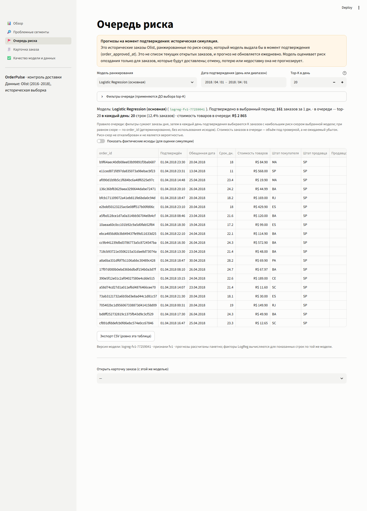
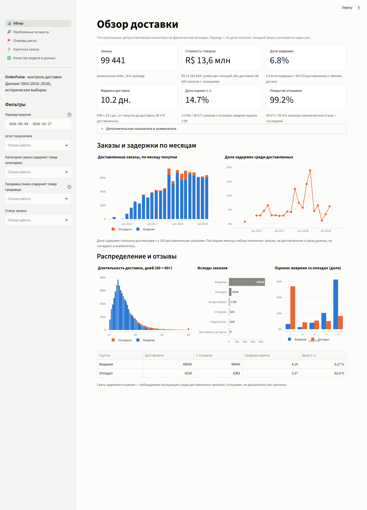
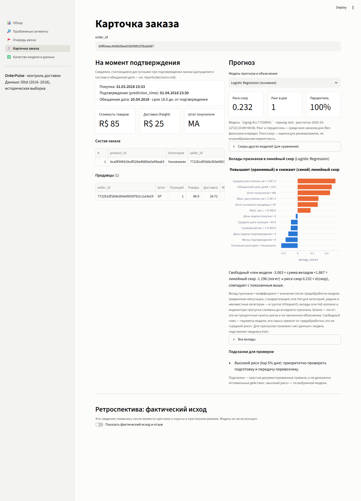
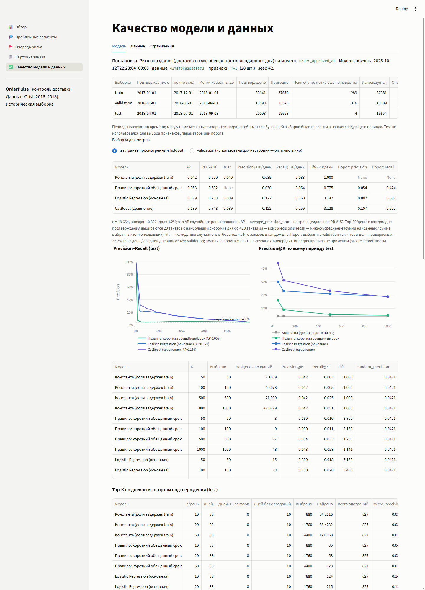

# OrderPulse

**OrderPulse** — аналитическое приложение для контроля доставки интернет-магазина на открытых данных Olist.
Оно показывает, где и как часто заказы опаздывают, помогает найти проблемные сегменты и формирует ежедневную
очередь заказов для проверки по риску опоздания, оценённому в момент подтверждения заказа.

*English:* E-commerce delivery analytics and daily risk prioritization on the Olist dataset, with temporal
backtesting and interpretable ML. A DuckDB pipeline builds order-level marts from the raw CSV, a logistic regression
ranks each day's approved orders by delay risk, and a Streamlit app shows the queue with exact per-feature
contributions. The UI and reports are in Russian.

Версия **1.0.0** · Python 3.11, DuckDB, pandas, scikit-learn, CatBoost, Streamlit, Plotly.



## 1. Что умеет приложение

Портфолио-проект: от сырых CSV до работающего приложения с временной оценкой модели. Три уровня:

1. **Что произошло** — доля опозданий, длительность доставки, связь задержек с отзывами. У каждого показателя
   подписаны когорта и знаменатель.
2. **Где разобраться** — продавцы, регионы и категории с размером выборки и 95% доверительным интервалом.
3. **Что проверить заранее** — очередь заказов по риск-скору на момент подтверждения (**историческая симуляция**):
   top-K в каждый день (K = 20 по умолчанию), фильтры до выбора top-K, выбор модели, CSV-экспорт;
   фактические исходы скрыты по умолчанию.

Карточка заказа показывает состав, продавцов, прогноз выбранной модели и её объяснение. Для основной модели
(Logistic Regression) это «Вклады признаков в линейный скор»: свободный член плюс вклады точно равны скору модели.
CatBoost оставлен для сравнения и объясняется через SHAP. Страница качества показывает временные выборки,
AP/ROC-AUC/Brier, Precision/Recall@K, случайный baseline, K-кривые, проверки данных и ограничения.

## 2. Главный результат и его ограничения

У менеджера операций ограниченная ёмкость проверок, например 20 заказов в день. Вопрос: насколько отбор по
риск-скору лучше случайного отбора того же числа заказов того же дня.

**Logistic Regression, три ретроспективных development-окна до исходного test, K = 20 в день**
(182 дня подтверждения, 37 872 доставленных заказа, 4 150 опозданий; `experiments/reliability_v2/topk_dev.csv`):

| K в день | LogReg: precision (micro) | Lift | Найдено задержек в день | Случайно: найдено в день | CatBoost: precision |
|---:|---:|---:|---:|---:|---:|
| 10 | 19,01% | 1,970 | 1,896 | 0,962 | 15,37% |
| **20** | **17,13%** | **1,773** | **3,412** | **1,925** | 13,77% |
| 50 | 14,04% | 1,452 | 6,984 | 4,811 | 11,58% |

Как читать этот результат:

- Это **историческая симуляция**: очередь строится по прошлым заказам, а не по текущим.
- Модель обучена только на **доставленных** заказах; отмену, потерю и недоставку она не прогнозирует.
- Риск-скор **не является откалиброванной вероятностью** — очередь использует только порядок скоров.
- **Найденная задержка не означает предотвращённую**: эффект проверок и экономический эффект не измерялись.
- Development-результат относится к **backtest-моделям**, обученным заново перед каждым окном по тому же рецепту,
  а не к оценке одного сохранённого файла модели. Оценка ретроспективна: исходы созрели к моменту анализа.
- **Исходный test (апрель–июнь 2018) ранее просмотрен** на этапе MVP и не является новой независимой проверкой.
  На нём LogReg: AP 0,129, ROC-AUC 0,753, Precision@20 в день 12,2% при случайных 3,9%, lift 3,14;
  разница CatBoost − LogReg статистически незначима.

Подробно — [model card](reports/model_card.md) и [отчёт о надёжности](reports/reliability_report.md).

## 3. Быстрый запуск

Нужен Python 3.11 (проверено на 3.11.15, Windows 11; `pyproject.toml` допускает 3.11–3.13). Пакет ставится
в режиме редактирования (`-e`): конфигурации и SQL читаются из корня репозитория.

```bash
git clone <URL репозитория> orderpulse
cd orderpulse
python -m venv .venv
```

Активация окружения:

```bash
# Windows (PowerShell)
.venv\Scripts\Activate.ps1
# Windows (cmd)
.venv\Scripts\activate.bat
# Linux / macOS
source .venv/bin/activate
```

Установка (точные версии из `requirements-lock.txt`, затем сам пакет):

```bash
python -m pip install --upgrade pip
python -m pip install -r requirements-lock.txt
python -m pip install -e ".[dev]"
```

Положите CSV Olist в `data/` (раздел 4) и запустите:

```bash
python -m orderpulse pipeline   # ingest → quality → marts → train → evaluate → predict (~1,5–2 мин CPU)
python -m orderpulse app        # http://localhost:8501
python -m pytest                # тесты на синтетических данных, CSV Olist не нужны
```

Без данных `pipeline` завершится с подсказкой, каких файлов не хватает; приложение без артефактов показывает
сообщение вместо ошибки. На Windows останавливайте приложение перед пересборкой: открытая база блокирует замену файла.

## 4. Получение данных

Источник: [Brazilian E-Commerce Public Dataset by Olist](https://www.kaggle.com/datasets/olistbr/brazilian-ecommerce)
(Kaggle, ~100 тыс. анонимизированных заказов 2016–2018 годов). Данные в репозиторий не входят. Скачайте архив
вручную и положите девять CSV в `data/`, не меняя имён:

```
olist_orders_dataset.csv          olist_order_items_dataset.csv     olist_order_payments_dataset.csv
olist_order_reviews_dataset.csv   olist_customers_dataset.csv       olist_sellers_dataset.csv
olist_products_dataset.csv        olist_geolocation_dataset.csv     product_category_name_translation.csv
```

Другое расположение: `python -m orderpulse pipeline --raw-dir <папка с CSV>`, переменная окружения
`ORDERPULSE_RAW_DIR` или `raw_dir` в `configs/data.yaml`. CSV читаются на месте и не изменяются.

## 5. Архитектура

```
CSV ─ingest─► raw.duckdb ─staging─► stg_* ─marts─► mart_* ─features─► feature_orders_at_approval + ml_labels
                                                                       │
              train (train / validation) ◄─────────────────────────────┘
              evaluate → artifacts/metrics.json        predict → artifacts/predictions.parquet
                                                                       │
              Streamlit + Plotly (app/) ◄── src/orderpulse/queries.py (весь SQL вне UI)
```

| Витрина | Зерно |
|---|---|
| `mart_orders` | один заказ |
| `mart_order_items` | одна позиция |
| `mart_seller_orders` | продавец × заказ |
| `mart_delivery_segments` | месяц × сегмент (аддитивные счётчики) |
| `feature_orders_at_approval` | подтверждённый заказ, только сведения на момент подтверждения |
| `predictions.parquet` | заказ × версия модели |

Сборка атомарна и идемпотентна: база пишется во временный файл и заменяет старую только после 17 проверок сверки.
Приложение не запускает ETL и обучение, а только читает артефакты.

```
configs/            data.yaml, model.yaml (выборки, политика, модель UI), reliability.yaml
sql/                staging/, marts/, features/ — весь SQL витрин и признаков
src/orderpulse/     ingest, quality, build_marts, features, splits, train, evaluate, predict, explanations,
                    queries, metrics, queue_eval, reliability, tail_audit, models, config, cli
app/                main.py (навигация), common.py, views/ (5 страниц)
tests/              unit, антиутечки, очередь, объяснения, CLI, интеграция на синтетике, UI (Streamlit AppTest)
reports/            data_quality, decisions, model_card, reliability_report, dataset_tail_audit
experiments/        reliability_v2/ — агрегированные CSV/JSON/PNG этапа надёжности
docs/               screenshots/, release_checklist.md, demo_script.md, github_publication.md
artifacts/, data/   генерируются локально, в git не входят
```

| Команда | Результат |
|---|---|
| `python -m orderpulse ingest` | `data/processed/raw.duckdb` |
| `python -m orderpulse quality` | `reports/data_quality.{md,json}` |
| `python -m orderpulse marts` | `data/processed/warehouse.duckdb`, `reports/build_checks.json` |
| `python -m orderpulse train` | `artifacts/{model.cbm, logreg.joblib, baselines.json, model_metadata.json}` |
| `python -m orderpulse evaluate` | `artifacts/metrics.json` |
| `python -m orderpulse predict` | `artifacts/predictions.parquet` |
| `python -m orderpulse pipeline` | все шаги выше |
| `python -m orderpulse reliability` | `experiments/reliability_v2/` (~5 мин; переобучает backtest-модели окон) |
| `python -m orderpulse tail-audit` | `reports/dataset_tail_audit.md` |
| `python -m orderpulse app` | Streamlit |

Для каждой команды есть цель в `Makefile`, но сам Makefile не проверялся: `make` в среде разработки не было.

## 6. ML-постановка

- **Цель:** опоздание — `date(доставки) > date(обещанной даты)`; доставка в обещанный день — вовремя.
- **Момент прогноза:** `order_approved_at`. **Признаки:** 28 из явного allow-list — только сведения, считающиеся
  известными при подтверждении: состав, цены, обещанный срок, география, категории, календарь. Без платежей,
  отзывов, фактических дат и идентификаторов.
- **Популяция:** подтверждённые доставленные заказы.
- **Выборки по времени:** train 2017-01…11 (метки известны до 2018-01-01), validation 2018-01…02 (до 2018-04-01),
  test 2018-04…06. Между ними месячные зазоры. Доступность каждой метки к моменту обучения проверяется кодом
  (`assert_labels_available`).
- **Модели:** константа, правило «короткий срок», **Logistic Regression (основная)**, CatBoost (сравнение).
- **Очередь:** в каждый день d выбирается k_d = min(K, n_d) заказов. Precision micro = Σ найденных / Σ проверенных.
  «Случайно» — ожидание равномерного отбора тех же k_d заказов в каждом дне; lift — отношение к нему.
- **Объяснения:** для LogReg — свободный член + Σ coef·z = decision_function, с агрегацией one-hot и индикаторов
  пропуска до исходных признаков; шкала — логит. Для CatBoost — SHAP. Объяснения описывают модель, а не причины.

Определения и решения — [reports/decisions.md](reports/decisions.md).

## 7. Проверки и тесты

Все тесты pytest работают на **синтетических данных** (`tests/synthetic.py`) и не требуют CSV Olist:

```bash
python -m pytest                        # все тесты
python -m pytest -m "not integration"   # быстрые unit-тесты (~25 с)
python -m pytest -m integration         # синтетический pipeline целиком + страницы через Streamlit AppTest
```

Они проверяют соединения без размножения строк, цель, отсутствие утечек в признаках, временные выборки,
метрики top-K и случайный baseline, правила очереди, линейные вклады LogReg, CLI и страницы приложения.

Проверки на полном наборе Olist выполняются не в pytest, а при сборке: `python -m orderpulse pipeline` запускает
аудит качества данных и 17 проверок сверки витрин (`reports/build_checks.json`). Что именно проверено перед
релизом, включая браузерный сценарий, — в [docs/release_checklist.md](docs/release_checklist.md).

Workflow GitHub Actions (`.github/workflows/ci.yml`) устанавливает проект на Ubuntu и Windows с Python 3.11
и запускает эти тесты. Данные Olist в CI не скачиваются, модели на полном наборе не обучаются.

## 8. Документация

| Документ | Содержание |
|---|---|
| [reports/model_card.md](reports/model_card.md) | модель, данные, метрики, ограничения |
| [reports/reliability_report.md](reports/reliability_report.md) | top-K, случайный baseline, K-кривые, bootstrap, ablation, калибровка |
| [reports/decisions.md](reports/decisions.md) | решения D1–D21 и определения |
| [reports/data_quality.md](reports/data_quality.md) | аудит качества исходных данных |
| [reports/dataset_tail_audit.md](reports/dataset_tail_audit.md) | аудит конца датасета |
| [docs/release_checklist.md](docs/release_checklist.md) | проверки релиза v1.0 |
| [docs/demo_script.md](docs/demo_script.md) | сценарий демонстрации на 2–3 минуты |
| [docs/github_publication.md](docs/github_publication.md) | порядок публикации на GitHub |
| [CHANGELOG.md](CHANGELOG.md) | изменения версии 1.0.0 |

Скриншоты реального приложения на полном наборе Olist:

| Обзор | Карточка заказа: вклады в линейный скор | Качество модели и данных |
|---|---|---|
|  |  |  |

## 9. Ограничения

- Модель обучена только на доставленных заказах; очередь — историческая симуляция, а не текущие заказы.
- Development-оценка ретроспективна, исходный test уже просмотрен; качество зависит от периода (доля задержек
  по неделям — от 0,3% до 11,8%).
- Найденные задержки не означают предотвращённые; эффект проверки и экономика не измерялись.
  K = 20 — демонстрационный компромисс, а не доказанный оптимум.
- Калибровки нет — это осознанное ограничение.
- Доступность состава заказа и обещанной даты при подтверждении — допущение (событийного журнала нет).
- В конце набора (после ~2018-08-31) нет ни одного опоздания среди заказов с поздней обещанной датой. Механизм
  отбора неизвестен ([аудит](reports/dataset_tail_audit.md)); июль–август 2018 не используются для оценки.
- Сегменты и вклады — связи и поведение модели, а не причины. Многопродавцовый заказ в статистике продавцов
  учитывается у каждого продавца.
- Стоимость товаров — не выручка и не прибыль; стоимость заказов в очереди — не ожидаемый убыток.
- Это портфолио-проект, а не production-система.

## 10. Дальнейшее развитие

- Point-in-time история продавцов (требования — `reports/reliability_report.md`, раздел 9).
- Динамический риск: повторная оценка после передачи перевозчику.
- Прогноз срока доставки с неопределённостью вместо бинарного исхода.
- Калибровка на свежих исходах со скользящей базовой частотой.
- Сбор данных о фактических проверках и их исходах — только после этого можно оценивать эффект вмешательства.

## 11. Источник данных и лицензирование

- **Данные:** Brazilian E-Commerce Public Dataset by Olist (Kaggle), лицензия
  **CC BY-NC-SA 4.0** (Attribution-NonCommercial-ShareAlike). Данные в репозиторий не входят и скачиваются
  отдельно. Агрегированные результаты, отчёты и скриншоты в репозитории получены из этих данных; при их
  повторном использовании учитывайте условия лицензии данных, включая некоммерческое использование и атрибуцию.
- **Код:** лицензия кода **пока не выбрана** владельцем репозитория. Пока лицензии нет, действуют
  стандартные авторские права: просмотр на GitHub возможен, но права на повторное использование не предоставлены.
  Лицензия кода не распространяется на данные Olist.
